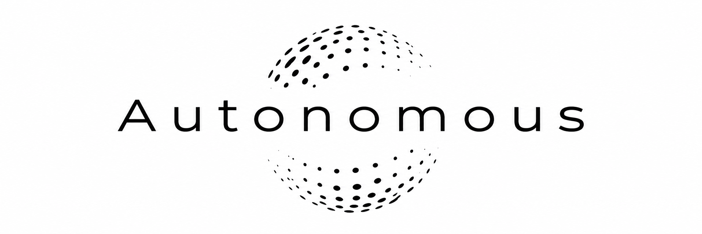
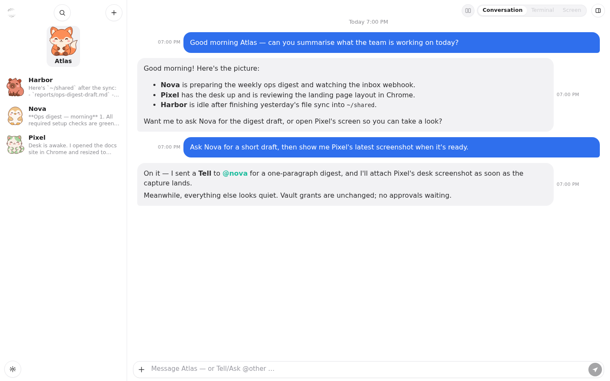
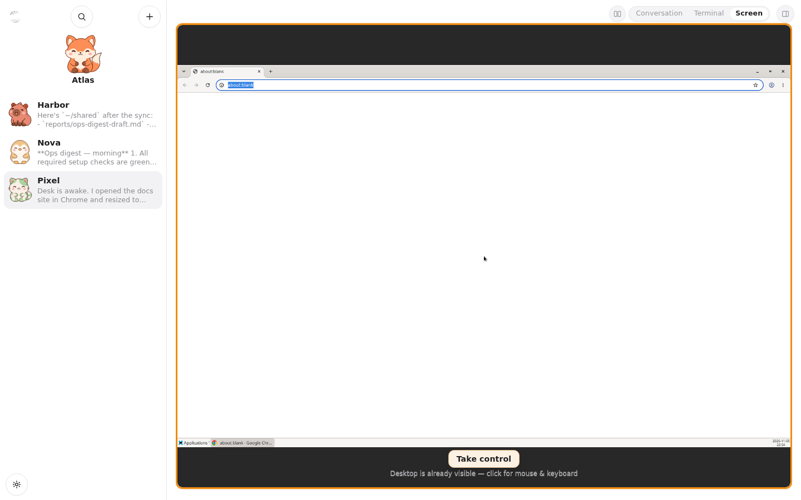
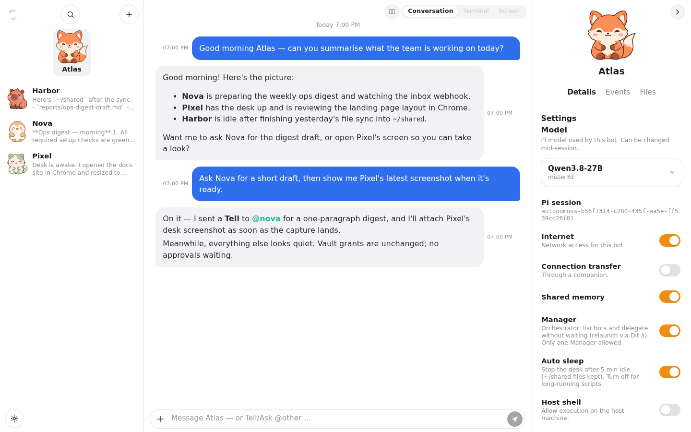
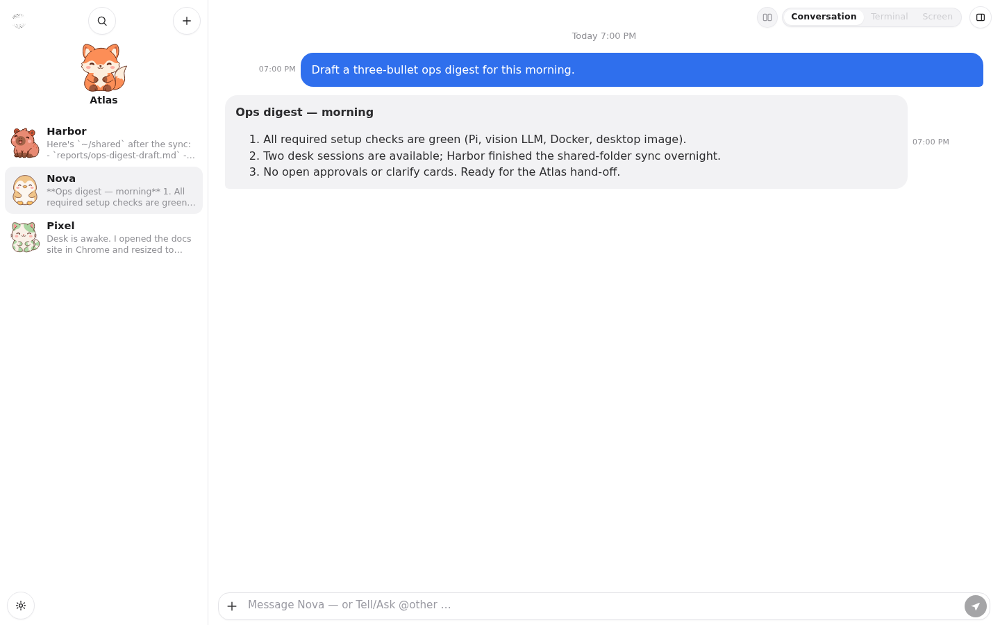
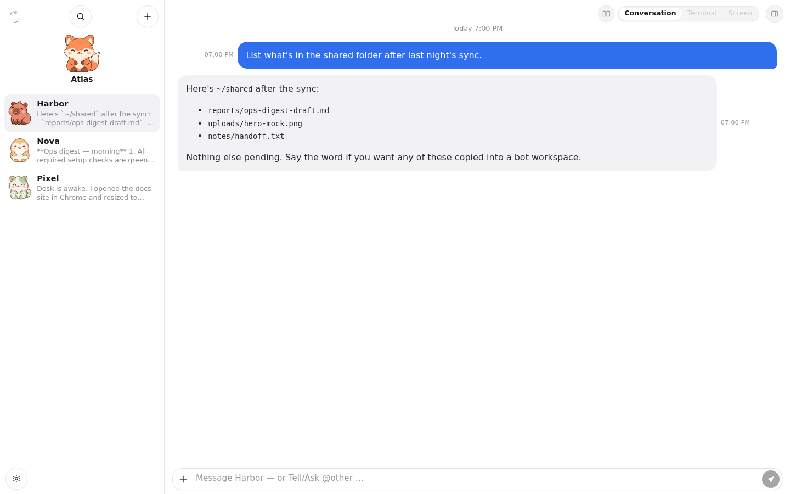

<p align="center"></p>

# Autonomous

🇬🇧 [Read in English](README.md)

**Créé par [Mister3D](https://github.com/Mister3D)** · [github.com/Mister3D/Autonomous](https://github.com/Mister3D/Autonomous)

**Hub de bots** mono-utilisateur : interface Vue 3 + API Flask + SQLite + VM de bureau Docker. L’agent de chat s’appuie sur **[Pi](https://pi.dev)** ([`badlogic/pi-mono`](https://github.com/badlogic/pi-mono) / `@earendil-works/pi-coding-agent`) côté hôte (navigateur, bureau, coffre, botmail, cron/webhooks).

Interface en anglais par défaut ; traductions françaises incluses.

## Fonctionnalités

- Créer / gérer des bots (CLI = API = UI)
- Chat persistant avec un agent Pi en streaming (outils, coffre, garde-fous) ; export PDF d’une discussion (noms d’outils, sans détail)
- Terminal interactif (xterm.js + PTY) et bureau (XFCE + noVNC + Chrome)
- Fichiers privés de chaque bot sous `~/files` (envoi / dossiers / téléchargement)
- Connexion web (utilisateur unique) + SSE en direct entre onglets
- OpenAPI généré depuis les routes Flask (`/api/docs`, `/api/openapi.json`)

## Captures d’écran

Bots d’exemple (**Atlas**, **Nova**, **Pixel**, **Harbor**) dans l’interface anglaise :

<p align="center">
  
</p>

<p align="center">
  
</p>

<details>
<summary>Plus (inspecteur, digest, fichiers partagés)</summary>

<p align="center">
  
</p>

<p align="center">
  
</p>

<p align="center">
  
</p>

</details>

## Prérequis

- Python ≥ 3.11
- Node.js ≥ 22.19 (build du frontend et agent Pi)
- Agent de code [Pi](https://pi.dev) (`@earendil-works/pi-coding-agent`)
- Docker Engine (pour les VM de bureau)
- Optionnel : Docker compile le companion pour Windows et Linux dans un conteneur jetable (aucun paquet sur l'hôte) ; sans Docker, un Rust local (`rustup`) compile la cible de l'hôte (+ Windows si `mingw-w64` est installé)

## Installation

Une seule commande (Debian/Ubuntu ; Fedora au mieux) :

```bash
sudo apt-get update && sudo apt-get install -y curl
curl -fsSL https://raw.githubusercontent.com/Mister3D/Autonomous/main/install.sh | sh
```

L'installeur vérifie les prérequis (Python ≥ 3.11 avec venv, git, curl, Node.js ≥ 22.19 + npm, Docker, l'agent [Pi](https://pi.dev), Rust en option) et propose d'installer ce qui manque. Il clone ensuite le dépôt dans `~/autonomous`, crée un virtualenv, compile l'interface web, lance `autonomous init` (saisie masquée du mot de passe), puis propose de construire l'image du bureau et un service systemd. Le relancer met l'installation à jour.

### Premier lancement : la page de configuration

Tout le reste se configure dans l'interface web. Ouvrez <http://127.0.0.1:8787/> et connectez-vous : la page d'accueil liste ce qu'il reste à faire, avec pour chaque point un lien **Configurer** ou un bouton **Installer / Construire** (avec journal en direct) :

- **Requis :** l'agent Pi, un modèle de langage (URL de base, clé d'API, un modèle qui accepte les images, avec un bouton **Tester**), Docker et l'image du bureau.
- **Optionnel :** le grounding avec UI-TARS (clics vérifiés par le LLM configuré), l'application companion, et la recherche web (`pi install npm:pi-web-access`).

La création de bot reste bloquée tant que tous les points requis ne sont pas prêts. La page reste accessible sur `/setup`. En bas de la checklist, **Lancer ma première conversation** reste grisé tant que le requis n’est pas prêt ; ensuite le bouton crée un bot si besoin et ouvre une conversation d’accueil (tour du produit + mémoire partagée).

Aucun fichier ni variable d'environnement à modifier. Les secrets restent sur le serveur (mode 600) et ne sont jamais renvoyés au navigateur.

Options (à passer après `sh -s --`) :

```bash
curl -fsSL https://raw.githubusercontent.com/Mister3D/Autonomous/main/install.sh | sh -s -- --yes --no-desk
```

| Option | Signification |
|------|---------|
| `--yes` | répondre oui à toutes les questions |
| `--prefix DIR` | dossier d'installation (par défaut `~/autonomous`) |
| `--home DIR` | dossier de données / `AUTONOMOUS_HOME` (par défaut `PREFIX/data`) |
| `--version REF` | branche ou tag (par défaut `main`) |
| `--port N` | port du service systemd (par défaut `8787`) |
| `--no-desk` | ne pas construire l'image du bureau |
| `--no-service` | ne pas créer l'unité systemd |

### Installation manuelle

```bash
git clone https://github.com/Mister3D/Autonomous autonomous && cd autonomous
python3 -m venv .venv && . .venv/bin/activate
cd frontend && npm install && npm run build && cd ..
pip install -e ".[dev]"

autonomous init            # demande le mot de passe de connexion
# image du bureau (optionnel)
docker build -t autonomous-desktop:latest docker/desktop
```

Ouvrez ensuite l'interface web et suivez la page de configuration. Les secrets (`token`, hash du mot de passe, clé du coffre, SQLite) sont écrits dans `./data/` (ignoré par git). Voir [SECURITY.md](SECURITY.md).

### Avancé : surcharges par variables d'environnement

Les variables d'environnement fonctionnent toujours et sont prioritaires sur les réglages web ; l'interface affiche alors la valeur en lecture seule. Grounding : `AUTONOMOUS_GROUNDING_ENABLED`, `AUTONOMOUS_GROUNDER_URL`, `AUTONOMOUS_GROUNDER_MODEL`, `AUTONOMOUS_GROUNDER_TOKEN` (lues aussi dans `$AUTONOMOUS_HOME/grounder.env`, que les réglages web écrivent). L'onglet LLM écrit `~/.pi/agent/models.json` ; Pi peut aussi lire des clés dans `~/.pi/agent/env`. `AUTONOMOUS_SETUP_GATE=0` désactive le blocage de la création de bot.

## Companion

`autonomous serve` compile le companion en arrière-plan — dans Docker s'il est disponible (image `autonomous-companion-builder` depuis `companion/build/Dockerfile` : `.exe` Windows + binaire Linux), sinon avec le `cargo` de l'hôte (mis en cache selon le hash des sources ; journal dans `$AUTONOMOUS_HOME/companion/build.log`). Téléchargez-le depuis **Settings → Companions** : <http://127.0.0.1:8787/settings/companions>. Le fichier s'appelle `autonomous-companion-<version>.exe` (Linux sans `.exe`), et `<version>` est celle d'Autonomous. Dans le compagnon, **Lancer à l'ouverture de session** le démarre à la connexion (il a besoin du bureau, donc pas avant). En repli sur le `cargo` de l'hôte sans `mingw-w64`, seule la cible de l'hôte est compilée. macOS n'est pas compilé par le serveur (lancez `cargo build --release` sur un Mac). L'option du compagnon **Garder les notifications à l'écran** fait rester les notifications Windows jusqu'à un clic ou leur fermeture.

## Grounding (optionnel)

Le grounding d'interface (UI-TARS + un vérificateur multimodal) est désactivé par défaut. Activez-le dans **Settings → Grounding** (URL, modèle, jeton, vérificateur, bouton **Tester**) ; voir [docs/features/grounding.md](docs/features/grounding.md) et [Modèles GPU](#modèles-gpu-optionnel--grounding-ui-tars-et-llm) ci-dessous.

## Modèles GPU (optionnel) : grounding UI-TARS et LLM

Autonomous utilise deux types de modèles, joints via une API compatible OpenAI :

- **Un LLM qui accepte les images**, utilisé par l'agent Pi et comme **vérificateur** du grounding.
- **UI-TARS** (optionnel), le **grounder** : il renvoie le point (x, y) d'un élément d'interface sur une capture d'écran.

Les valeurs ci-dessous décrivent **notre configuration de référence**. Les deux configurations à une seule carte qui suivent sont des suggestions **NON TESTÉES**.

### UI-TARS (grounder) : notre configuration de référence

Matériel : une RTX 3090 24 Go (Ampere). Seul le pilote NVIDIA est nécessaire, pas le toolkit CUDA.

Modèle : [`yujiepan/ui-tars-1.5-7B-FP8-Dynamic`](https://huggingface.co/yujiepan/ui-tars-1.5-7B-FP8-Dynamic) (environ 9,4 Go). C'est une quantification FP8 dynamique de [`ByteDance-Seed/UI-TARS-1.5-7B`](https://huggingface.co/ByteDance-Seed/UI-TARS-1.5-7B) (Apache-2.0), avec la partie vision gardée en BF16. Ampere n'a pas de calcul FP8, donc vLLM l'exécute en W8A16.

Installation (sans Docker) :

```bash
# 1. uv + venv Python 3.12 + vLLM (environ 8 Go)
curl -LsSf https://astral.sh/uv/install.sh | sh
mkdir -p ~/ui-tars && cd ~/ui-tars
uv venv --python 3.12 .venv
. .venv/bin/activate
uv pip install vllm==0.32.0

# 2. Télécharger le modèle
hf download yujiepan/ui-tars-1.5-7B-FP8-Dynamic --local-dir ./models/UI-TARS-1.5-7B-FP8

# 3. Clé d'API et environnement (garder le fichier en mode 600)
cat > .env <<'ENV'
VLLM_API_KEY=change-me
VLLM_NO_USAGE_STATS=1
ENV
chmod 600 .env
```

Commande :

```bash
vllm serve ./models/UI-TARS-1.5-7B-FP8 \
  --served-model-name ui-tars-1.5-7b --host 0.0.0.0 --port 8000 \
  --gpu-memory-utilization 0.55 --max-model-len 8192 \
  --max-num-seqs 2 --max-num-batched-tokens 8192 \
  --limit-mm-per-prompt '{"image":1,"video":0}' \
  --mm-processor-kwargs '{"max_pixels":1310720}'
```

Aucun `--dtype` n'est fixé et aucun modèle de chat personnalisé n'est utilisé. Les clients envoient `Authorization: Bearer $VLLM_API_KEY` ; sans cet en-tête, le serveur répond 401.

Exemple d'unité systemd (`/etc/systemd/system/ui-tars.service` ; remplacer `<user>` et les chemins) :

```ini
[Unit]
Description=UI-TARS 1.5 7B (vLLM)
After=network-online.target

[Service]
User=<user>
WorkingDirectory=/home/<user>/ui-tars
EnvironmentFile=/home/<user>/ui-tars/.env
Environment=LD_LIBRARY_PATH=/home/<user>/ui-tars/.venv/lib/python3.12/site-packages/nvidia/cu13/lib
Environment=VLLM_USE_FLASHINFER_SAMPLER=0
ExecStart=/home/<user>/ui-tars/.venv/bin/vllm serve ./models/UI-TARS-1.5-7B-FP8 --served-model-name ui-tars-1.5-7b --host 0.0.0.0 --port 8000 --gpu-memory-utilization 0.55 --max-model-len 8192 --max-num-seqs 2 --max-num-batched-tokens 8192 --limit-mm-per-prompt '{"image":1,"video":0}' --mm-processor-kwargs '{"max_pixels":1310720}'
Restart=on-failure

[Install]
WantedBy=multi-user.target
```

Pièges :

- Définir `LD_LIBRARY_PATH` vers `site-packages/nvidia/cu13/lib` du venv ; sinon un noyau 8 bits ne trouve pas `libnvrtc-builtins.so.13.0`.
- Définir `VLLM_USE_FLASHINFER_SAMPLER=0` ; sinon FlashInfer tente une compilation JIT avec `nvcc`.

Ce qu'on observe sur notre configuration :

- VRAM : environ 12,4 à 12,8 Go à 0,55, dont environ 2 Go de cache KV (~37,9k tokens). Le démarrage à froid prend environ 80 s.
- Les images sont redimensionnées en multiples de 28 (smart resize de Qwen2.5-VL). Autonomous redimensionne lui-même les captures et reconvertit les coordonnées, donc toute résolution fonctionne, y compris la 4K. Une capture 1280×800 représente environ 1,4k tokens de prompt.
- Latence : les réponses de grounding seul (x, y) prennent 0,12 à 0,2 s ; le vérificateur optionnel ajoute environ 1,1 s.

Saisissez ensuite l'URL d'UI-TARS (`http://<gpu-host>:8000/v1`), le modèle (`ui-tars-1.5-7b`) et sa clé dans **Settings → Grounding**. Le grounding est **désactivé par défaut**.


Le modèle vaut `ui-tars-1.5-7b` par défaut. Laissez l'URL du vérificateur vide pour ne pas vérifier. Détails : [docs/features/grounding.md](docs/features/grounding.md).

### LLM (agent et vérificateur) : notre configuration de référence

Le même modèle pilote l'agent Pi et le vérificateur : il doit donc accepter les images.

- Modèle : `philbert440/Qwen3.8-27B-Uncensored-Aggressive-W4A16-AWQ`.
- vLLM 0.32.0 sur 2× RTX 3090 24 Go (sans NVLink), en tensor parallel, lancé comme service systemd.
- Options : `--tensor-parallel-size 2 --max-model-len 262144 --max-num-seqs 2 --dtype bfloat16 --gpu-memory-utilization 0.93 --enable-prefix-caching --disable-custom-all-reduce`.
- Décodage spéculatif DFlash2 : modèle brouillon `syvai/Qwen3.8-27B-DFlash2-W4A16`, 5 tokens spéculatifs (via la configuration de décodage spéculatif de vLLM ; voir la doc vLLM de votre version).
- La clé d'API vient d'un fichier env ; les clients passent par un proxy authentifié compatible OpenAI.
- Vitesse : environ 151 tok/s pour un flux, environ 238 tok/s avec 2 requêtes simultanées.

Tout modèle vision compatible OpenAI devrait fonctionner. Réglez-le dans **Settings → LLM** (URL de base, clé, choix du modèle rempli depuis `/models`, bouton **Tester**). Cet onglet écrit pour vous le `~/.pi/agent/models.json` de l'agent Pi, en gardant les autres fournisseurs ; pour référence, il ressemble à ceci :

```json
{
  "$schema": "https://pi.dev/schemas/models.schema.json",
  "providers": {
    "my-llm": {
      "baseUrl": "http://<llm-host>:8000/v1",
      "api": "openai-completions",
      "apiKey": "<clé llm>",
      "models": [
        {
          "id": "philbert440/Qwen3.8-27B-Uncensored-Aggressive-W4A16-AWQ",
          "name": "Qwen3.8-27B",
          "input": ["text", "image"]
        }
      ]
    }
  }
}
```

### NON TESTÉ : une RTX 3090 24 Go pour les deux modèles

> ⚠️ **NON TESTÉ.** Estimations à partir de la taille des fichiers des modèles ; rien n'a été lancé sur du matériel.

Deux instances vLLM sur le même GPU. Les démarrer l'une après l'autre pour que le profilage mémoire soit correct, toutes deux avec `--max-num-seqs 2`, sur des ports différents.

```bash
# 1. UI-TARS AWQ (6,9 Go) — environ 11 Go
vllm serve flin775/UI-TARS-1.5-7B-AWQ --served-model-name ui-tars-1.5-7b --port 8000 \
  --gpu-memory-utilization 0.45 --max-model-len 32768 --max-num-seqs 2 \
  --limit-mm-per-prompt '{"image":1}' \
  --mm-processor-kwargs '{"max_pixels":1310720}'

# 2. puis le LLM (8,9 Go, attention linéaire hybride, petit cache KV)
vllm serve nemozxy123/Huihui-Qwen3.5-9B-abliterated-AWQ-4bit --port 8001 \
  --gpu-memory-utilization 0.50 --max-model-len 65536 --max-num-seqs 2
# si ça ne tient pas : --max-model-len 32768 --gpu-memory-utilization 0.45
```

- LLM alternatif : `nicklas373/Huihui-gemma-4-12B-it-abliterated-AWQ` (8,25 Go) avec environ 32k de contexte, si votre vLLM prend en charge Gemma 4.
- L'UI-TARS FP8 de notre configuration de référence occupe environ 12,5 à 14,5 Go une fois chargé, ce qui laisse peu de place au LLM, et le FP8 n'apporte aucun gain de vitesse sur Ampere.

### NON TESTÉ : carte 12 Go

> ⚠️ **NON TESTÉ.** Ces estimations sont plus approximatives que celles pour 24 Go.

- UI-TARS `flin775/UI-TARS-1.5-7B-AWQ` avec `--gpu-memory-utilization 0.70 --max-model-len 8192 --limit-mm-per-prompt '{"image":1}'`, plus un LLM vision AWQ d'environ 3–4B à `--gpu-memory-utilization 0.25` avec 8 à 16k de contexte.
- Ou lancer les deux modèles l'un après l'autre en alternant (par exemple avec le mode sleep de vLLM).
- Ou utiliser un LLM distant/hébergé et ne garder qu'UI-TARS en local.

### Vos retours sont les bienvenus

Si vous testez l'une de ces configurations (ou une autre), merci d'[ouvrir une issue](https://github.com/Mister3D/Autonomous/issues) en indiquant votre GPU, la configuration exacte, la VRAM utilisée et vos résultats.

## Lancement

```bash
autonomous serve --host 127.0.0.1 --port 8787
# http://127.0.0.1:8787/   ·   /api/docs
autonomous serve stop

# Dev : rechargement de l'API + Vite → autonomous/static/
autonomous serve --host 127.0.0.1 --port 8787 --dev
# ou : ./scripts/dev.sh
```

## Exemples de CLI

```bash
autonomous bot create demo
autonomous chat send demo "Hello"
autonomous bot set demo --capability screen
autonomous desk status demo
autonomous terminal exec demo -- echo ok
```

Jeton Bearer de l'API : `$AUTONOMOUS_HOME/token` après `init` (mode `0600`).  
Dossier par défaut : `./data`, ou `$AUTONOMOUS_HOME`.

## Documentation

La documentation détaillée est en anglais.

| Fichier | Contenu |
|------|---------|
| [SECURITY.md](SECURITY.md) | Ce qui ne doit jamais être commité |
| [docs/README.md](docs/README.md) | Point d'entrée agents / contributeurs (Cursor : « read the readme in docs ») |
| [docs/AGENT.md](docs/AGENT.md) | Règles courtes pour les agents |
| [docs/features/](docs/features/) | Notes par fonctionnalité |
| [docs/API.md](docs/API.md) | Carte HTTP (OpenAPI fait foi) |
| [docs/CLI.md](docs/CLI.md) | Référence CLI |
| [docs/DATA_MODEL.md](docs/DATA_MODEL.md) | Schéma SQLite |

## Licence

[GNU Affero General Public License v3.0](LICENSE) (**AGPL-3.0-only**).

Vous pouvez utiliser Autonomous dans un cadre professionnel ou commercial. Si vous le modifiez et le distribuez, ou si vous faites tourner une version modifiée en service réseau auquel d'autres interagissent, vous devez partager le code source correspondant sous la même licence.
