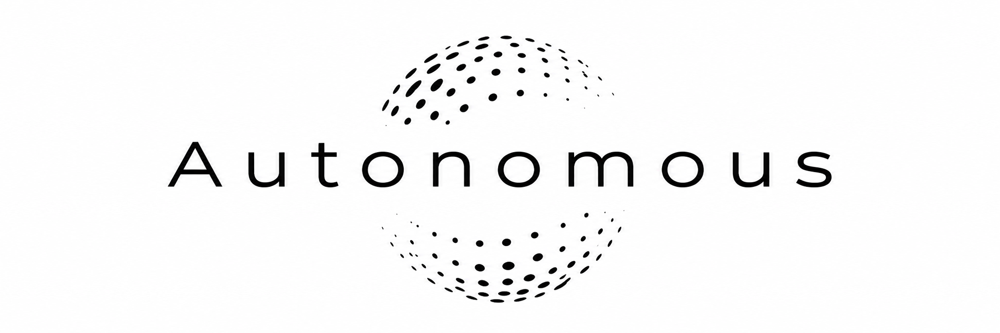
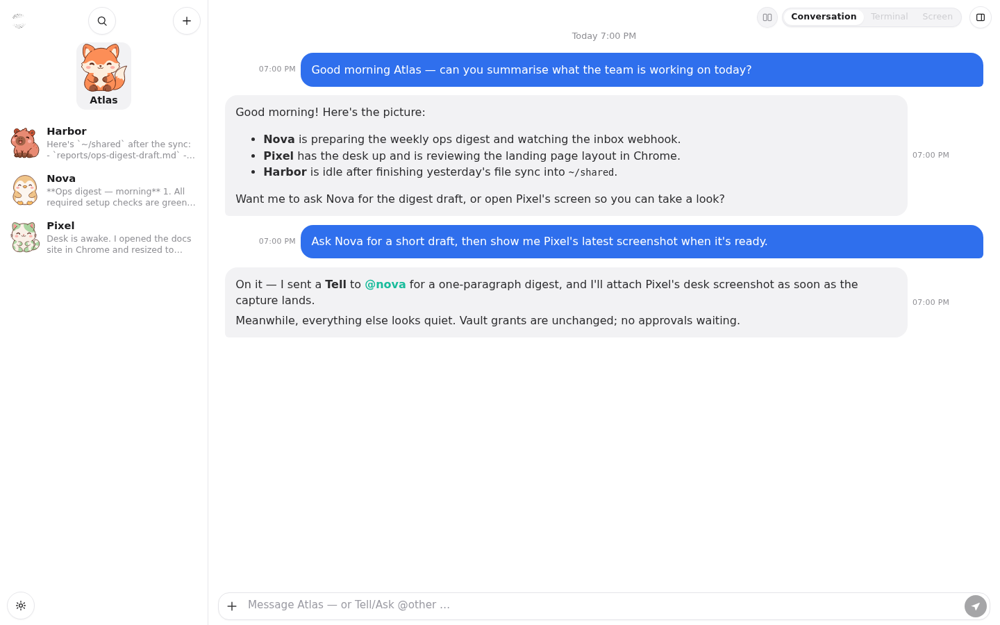
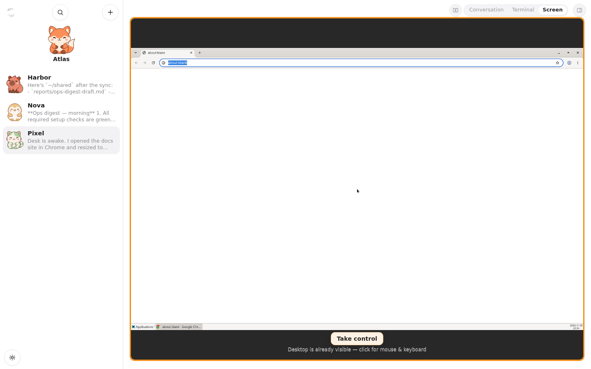
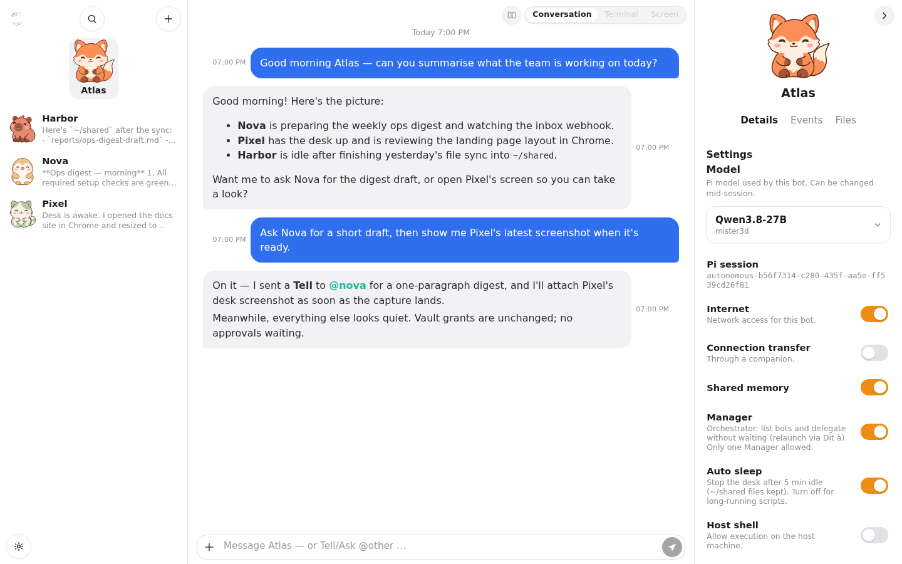
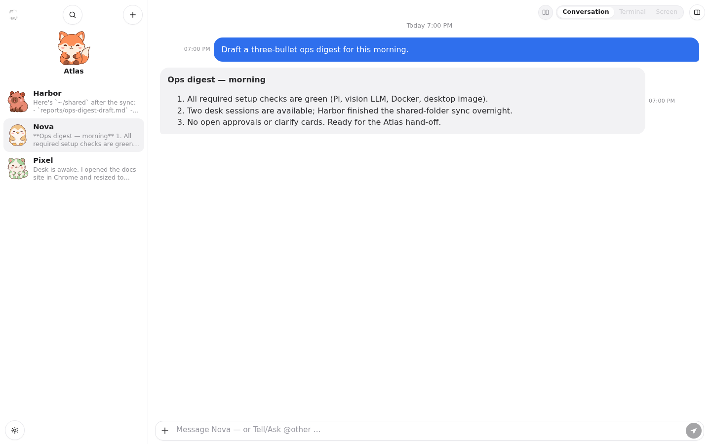
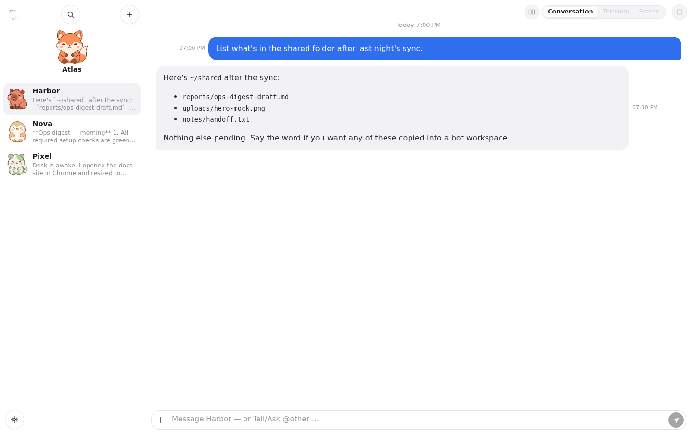

<p align="center"></p>

# Autonomous

🇫🇷 [Lire en français](README-FR.md)

**Created by [Mister3D](https://github.com/Mister3D)** · [github.com/Mister3D/Autonomous](https://github.com/Mister3D/Autonomous)

Mono-user **bot hub**: Vue 3 UI + Flask API + SQLite + Docker desktop VMs. The chat agent is powered by **[Pi](https://pi.dev)** ([`badlogic/pi-mono`](https://github.com/badlogic/pi-mono) / `@earendil-works/pi-coding-agent`) running on the host (browser, desk, vault, botmail, cron/webhooks).

English UI by default; French translations included.

## Features

- Create / manage bots (CLI = API = UI)
- Persistent chat with a streaming Pi agent (tools, vault, guard-rails); export a discussion to PDF (tool names, no details)
- Interactive terminal (xterm.js + PTY) and desktop (XFCE + noVNC + Chrome)
- Shared files under `~/shared` (upload / folders / download)
- Web login (single user) + live SSE across tabs
- OpenAPI from Flask routes (`/api/docs`, `/api/openapi.json`)

## Screenshots

Example bots (**Atlas**, **Nova**, **Pixel**, **Harbor**) in the English UI:

<p align="center">
  
</p>

<p align="center">
  
</p>

<details>
<summary>More (inspector, digest, shared files)</summary>

<p align="center">
  
</p>

<p align="center">
  
</p>

<p align="center">
  
</p>

</details>

## Requirements

- Python ≥ 3.11
- Node.js ≥ 22.19 (frontend build and the Pi agent)
- [Pi](https://pi.dev) coding agent (`@earendil-works/pi-coding-agent`)
- Docker Engine (for desk VMs)
- Optional: Docker builds the companion app for Windows and Linux in a throwaway container (no host packages); without Docker, a host Rust (`rustup`) builds the host target only (+ Windows if `mingw-w64` is installed)

## Install

One command (Debian/Ubuntu; Fedora best effort):

```bash
sudo apt-get update && sudo apt-get install -y curl
curl -fsSL https://raw.githubusercontent.com/Mister3D/Autonomous/main/install.sh | sh
```

The installer checks the prerequisites (Python ≥ 3.11 with venv, git, curl, Node.js ≥ 22.19 + npm, Docker, the [Pi](https://pi.dev) agent, optionally Rust) and offers to install what is missing. It then clones the repo into `~/autonomous`, creates a virtualenv, builds the web UI, runs `autonomous init` (hidden password prompt), and optionally builds the desktop image and a systemd service. Re-running it updates the install.

### First launch: the setup page

Everything else is configured in the web UI. Open <http://127.0.0.1:8787/> and log in: the home page lists what is left to do, with a **Configure** link or an **Install / Build** button (with a live log) for each item:

- **Required:** the Pi agent, a language model (base URL, API key, a model that accepts images, with a **Test** button), Docker and the desktop image.
- **Optional:** grounding with UI-TARS (clicks are verified by the configured LLM) and the companion app.

Creating a bot stays locked until every required item is ready. The page stays available at `/setup`. At the bottom of the checklist, **Start my first conversation** stays greyed out until the required items are ready; then it creates a bot if needed and opens an onboarding chat (product tour + shared memory).

You don't need to edit any file or environment variable. Secrets stay on the server (mode 600) and are never sent back to the browser.

Options (pass them after `sh -s --`):

```bash
curl -fsSL https://raw.githubusercontent.com/Mister3D/Autonomous/main/install.sh | sh -s -- --yes --no-desk
```

| Flag | Meaning |
|------|---------|
| `--yes` | answer yes to every question |
| `--prefix DIR` | install directory (default `~/autonomous`) |
| `--home DIR` | data directory / `AUTONOMOUS_HOME` (default `PREFIX/data`) |
| `--version REF` | branch or tag (default `main`) |
| `--port N` | port for the systemd service (default `8787`) |
| `--no-desk` | skip the desktop image build |
| `--no-service` | skip the systemd unit |

### Manual install

```bash
git clone https://github.com/Mister3D/Autonomous autonomous && cd autonomous
python3 -m venv .venv && . .venv/bin/activate
cd frontend && npm install && npm run build && cd ..
pip install -e ".[dev]"

autonomous init            # prompts for the login password
# optional desktop image
docker build -t autonomous-desktop:latest docker/desktop
```

Then open the web UI and follow the setup page. Secrets (`token`, password hash, vault key, SQLite) are written under `./data/` (gitignored). See [SECURITY.md](SECURITY.md).

### Advanced: environment overrides

Environment variables still work and take precedence over the web settings; the UI then shows the value as read-only. Grounding: `AUTONOMOUS_GROUNDING_ENABLED`, `AUTONOMOUS_GROUNDER_URL`, `AUTONOMOUS_GROUNDER_MODEL`, `AUTONOMOUS_GROUNDER_TOKEN` (also read from `$AUTONOMOUS_HOME/grounder.env`, which the web settings write). The LLM tab writes `~/.pi/agent/models.json`; Pi can also read keys from `~/.pi/agent/env`. `AUTONOMOUS_SETUP_GATE=0` disables the bot-creation lock.

## Companion

`autonomous serve` builds the companion in the background — in Docker when available (image `autonomous-companion-builder` from `companion/build/Dockerfile`: Windows `.exe` + Linux binary), otherwise with the host `cargo` (cached by source hash; log in `$AUTONOMOUS_HOME/companion/build.log`). Download it from **Settings → Companions**: <http://127.0.0.1:8787/settings/companions>. Host-cargo fallback without `mingw-w64` builds only the host target. macOS binaries are not built by the server (run `cargo build --release` on a Mac). Companion option **Keep notifications on screen** makes Windows toasts stay until clicked or dismissed.

## Grounding (optional)

GUI grounding (UI-TARS) is disabled by default. Turn it on in **Settings → Grounding** (URL, token, model, **Test** button); each click is double-checked by the LLM configured in **Settings → LLM**, there is no separate verifier to set up; see [docs/features/grounding.md](docs/features/grounding.md) and [GPU models](#gpu-models-optional-ui-tars-grounding-and-llm) below.

## GPU models (optional): UI-TARS grounding and LLM

Autonomous needs two kinds of model, both reached over an OpenAI-compatible API:

- **An LLM that accepts images**, used by the Pi agent and to **verify** grounded clicks.
- **UI-TARS** (optional), the **grounder**: it returns the (x, y) point of a UI element on a screenshot.

The values below describe **our reference setup**. The two single-card setups after it are **UNTESTED** suggestions.

### UI-TARS (grounder): our reference setup

Hardware: one RTX 3090 24 GB (Ampere). Only the NVIDIA driver is needed, not the CUDA toolkit.

Model: [`yujiepan/ui-tars-1.5-7B-FP8-Dynamic`](https://huggingface.co/yujiepan/ui-tars-1.5-7B-FP8-Dynamic) (about 9.4 GB). It is an FP8-dynamic quant of [`ByteDance-Seed/UI-TARS-1.5-7B`](https://huggingface.co/ByteDance-Seed/UI-TARS-1.5-7B) (Apache-2.0), with the vision tower kept in BF16. Ampere has no FP8 compute, so vLLM runs it as W8A16.

Install (no Docker):

```bash
# 1. uv + Python 3.12 venv + vLLM (about 8 GB)
curl -LsSf https://astral.sh/uv/install.sh | sh
mkdir -p ~/ui-tars && cd ~/ui-tars
uv venv --python 3.12 .venv
. .venv/bin/activate
uv pip install vllm==0.32.0

# 2. Download the model
hf download yujiepan/ui-tars-1.5-7B-FP8-Dynamic --local-dir ./models/UI-TARS-1.5-7B-FP8

# 3. API key and environment (keep the file mode 600)
cat > .env <<'ENV'
VLLM_API_KEY=change-me
VLLM_NO_USAGE_STATS=1
ENV
chmod 600 .env
```

Command:

```bash
vllm serve ./models/UI-TARS-1.5-7B-FP8 \
  --served-model-name ui-tars-1.5-7b --host 0.0.0.0 --port 8000 \
  --gpu-memory-utilization 0.55 --max-model-len 8192 \
  --max-num-seqs 2 --max-num-batched-tokens 8192 \
  --limit-mm-per-prompt '{"image":1,"video":0}' \
  --mm-processor-kwargs '{"max_pixels":1310720}'
```

No `--dtype` is set and no custom chat template is used. Clients send `Authorization: Bearer $VLLM_API_KEY`; without it the server returns 401.

Example systemd unit (`/etc/systemd/system/ui-tars.service`; replace `<user>` and the paths):

```ini
[Unit]
Description=UI-TARS 1.5 7B (vLLM)
After=network-online.target

[Service]
User=<user>
WorkingDirectory=/home/<user>/ui-tars
EnvironmentFile=/home/<user>/ui-tars/.env
Environment=LD_LIBRARY_PATH=/home/<user>/ui-tars/.venv/lib/python3.12/site-packages/nvidia/cu13/lib
Environment=VLLM_USE_FLASHINFER_SAMPLER=0
ExecStart=/home/<user>/ui-tars/.venv/bin/vllm serve ./models/UI-TARS-1.5-7B-FP8 --served-model-name ui-tars-1.5-7b --host 0.0.0.0 --port 8000 --gpu-memory-utilization 0.55 --max-model-len 8192 --max-num-seqs 2 --max-num-batched-tokens 8192 --limit-mm-per-prompt '{"image":1,"video":0}' --mm-processor-kwargs '{"max_pixels":1310720}'
Restart=on-failure

[Install]
WantedBy=multi-user.target
```

Gotchas:

- Set `LD_LIBRARY_PATH` to the venv's `site-packages/nvidia/cu13/lib`; otherwise an 8-bit kernel can't find `libnvrtc-builtins.so.13.0`.
- Set `VLLM_USE_FLASHINFER_SAMPLER=0`; otherwise FlashInfer tries to JIT-compile with `nvcc`.

What to expect on our setup:

- VRAM: about 12.4–12.8 GB at 0.55, including about 2 GB of KV cache (~37.9k tokens). Cold start takes about 80 s.
- Images are resized to multiples of 28 (Qwen2.5-VL smart resize). Autonomous resizes screenshots itself and converts the coordinates back, so any resolution works, including 4K. A 1280×800 screenshot is about 1.4k prompt tokens.
- Latency: grounding-only (x, y) answers take 0.12–0.2 s; verification by the LLM adds about 1.1 s.

Then enter the UI-TARS URL (`http://<gpu-host>:8000/v1`), the model (`ui-tars-1.5-7b`) and its key in **Settings → Grounding**. Grounding is **disabled by default**.


The model defaults to `ui-tars-1.5-7b`. Clicks are verified by the LLM from **Settings → LLM**. Details: [docs/features/grounding.md](docs/features/grounding.md).

### LLM (agent and click verification): our reference setup

The same model drives the Pi agent and verifies grounded clicks, so it must accept images.

- Model: `philbert440/Qwen3.8-27B-Uncensored-Aggressive-W4A16-AWQ`.
- vLLM 0.32.0 on 2× RTX 3090 24 GB (no NVLink), tensor parallel, run as a systemd service.
- Flags: `--tensor-parallel-size 2 --max-model-len 262144 --max-num-seqs 2 --dtype bfloat16 --gpu-memory-utilization 0.93 --enable-prefix-caching --disable-custom-all-reduce`.
- Speculative decoding with DFlash2: draft model `syvai/Qwen3.8-27B-DFlash2-W4A16`, 5 speculative tokens (set through vLLM's speculative-decoding config; check the vLLM docs for your version).
- The API key comes from an env file; clients go through an authenticated OpenAI-compatible proxy.
- Speed: about 151 tok/s for one stream, about 238 tok/s with 2 concurrent requests.

Any OpenAI-compatible vision model should work. Set it in **Settings → LLM** (base URL, key, model picker filled from `/models`, **Test** button). That tab writes the Pi agent's `~/.pi/agent/models.json` for you, keeping other providers; for reference it looks like this:

```json
{
  "$schema": "https://pi.dev/schemas/models.schema.json",
  "providers": {
    "my-llm": {
      "baseUrl": "http://<llm-host>:8000/v1",
      "api": "openai-completions",
      "apiKey": "<llm key>",
      "models": [
        {
          "id": "philbert440/Qwen3.8-27B-Uncensored-Aggressive-W4A16-AWQ",
          "name": "Qwen3.8-27B",
          "input": ["text", "image"]
        }
      ]
    }
  }
}
```

### UNTESTED: one RTX 3090 24 GB for both models

> ⚠️ **UNTESTED.** Estimated from model file sizes; not run on hardware.

Two vLLM instances on the same GPU. Start them one after the other so memory profiling is right, both with `--max-num-seqs 2`, on different ports.

```bash
# 1. UI-TARS AWQ (6.9 GB) — about 11 GB
vllm serve flin775/UI-TARS-1.5-7B-AWQ --served-model-name ui-tars-1.5-7b --port 8000 \
  --gpu-memory-utilization 0.45 --max-model-len 32768 --max-num-seqs 2 \
  --limit-mm-per-prompt '{"image":1}' \
  --mm-processor-kwargs '{"max_pixels":1310720}'

# 2. then the LLM (8.9 GB, hybrid linear attention, small KV cache)
vllm serve nemozxy123/Huihui-Qwen3.5-9B-abliterated-AWQ-4bit --port 8001 \
  --gpu-memory-utilization 0.50 --max-model-len 65536 --max-num-seqs 2
# if it doesn't fit: --max-model-len 32768 --gpu-memory-utilization 0.45
```

- Alternative LLM: `nicklas373/Huihui-gemma-4-12B-it-abliterated-AWQ` (8.25 GB) at about 32k context, if your vLLM supports Gemma 4.
- The FP8 UI-TARS from our reference setup takes about 12.5–14.5 GB once loaded, leaving little room for the LLM, and FP8 gives no speed gain on Ampere.

### UNTESTED: 12 GB card

> ⚠️ **UNTESTED.** These estimates are rougher than the 24 GB ones.

- UI-TARS `flin775/UI-TARS-1.5-7B-AWQ` with `--gpu-memory-utilization 0.70 --max-model-len 8192 --limit-mm-per-prompt '{"image":1}'`, plus a ~3–4B AWQ vision LLM at `--gpu-memory-utilization 0.25` with 8–16k context.
- Or run the two models one at a time and swap between them (e.g. vLLM sleep mode).
- Or use a remote/hosted LLM and keep only UI-TARS locally.

### Feedback welcome

If you test one of these setups (or another one), please [open an issue](https://github.com/Mister3D/Autonomous/issues) with your GPU, the exact config, the VRAM used and your results.

## Run

```bash
autonomous serve --host 127.0.0.1 --port 8787
# http://127.0.0.1:8787/   ·   /api/docs
autonomous serve stop

# Dev: API reload + Vite → autonomous/static/
autonomous serve --host 127.0.0.1 --port 8787 --dev
# or: ./scripts/dev.sh
```

## CLI examples

```bash
autonomous bot create demo
autonomous chat send demo "Hello"
autonomous bot set demo --capability screen
autonomous desk status demo
autonomous terminal exec demo -- echo ok
```

API Bearer token: `$AUTONOMOUS_HOME/token` after `init` (mode `0600`).  
Default home: `./data`, or `$AUTONOMOUS_HOME`.

## Docs

| File | Content |
|------|---------|
| [SECURITY.md](SECURITY.md) | What must never be committed |
| [docs/README.md](docs/README.md) | Agent / contributor entry (Cursor: "read the readme in docs") |
| [docs/AGENT.md](docs/AGENT.md) | Short agent rules |
| [docs/features/](docs/features/) | Feature notes |
| [docs/API.md](docs/API.md) | HTTP map (OpenAPI is source of truth) |
| [docs/CLI.md](docs/CLI.md) | CLI reference |
| [docs/DATA_MODEL.md](docs/DATA_MODEL.md) | SQLite schema |

## License

[GNU Affero General Public License v3.0](LICENSE) (**AGPL-3.0-only**).

You may use Autonomous in a professional or commercial setting. If you modify it and distribute it, or run a modified version as a network service that others interact with, you must share the corresponding source under the same license.
